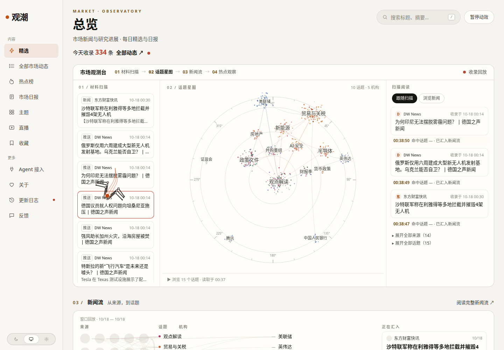
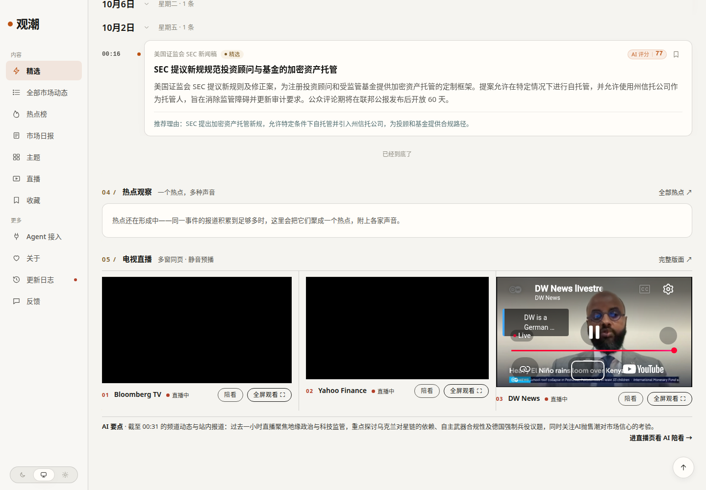

# 观潮 · 市场观测台

**观潮**是一台为中文读者打造的市场新闻观测台：它全天候盯着全球 67 个财经信源，把新闻采集、翻译、筛选、归组、解读成一张「报纸式」的网页——有观测台、有星图、有河流、有日报，还有一面能同页看 Bloomberg / Yahoo Finance / DW 的电视直播墙，和一位会跟着你所看的频道生成要点的 AI 陪看。

站名「观潮」：观天下之潮，潮即市场。



总览页。左侧是材料扫描列，机械蜘蛛正沿卡片逐篇读取；中间是话题星图，节点带常驻计数与刻度环，被扫中的话题会亮起；右列是扫描阅读，读完的条目带着命中话题汇入新闻流。今天收录 334 条。


电视直播窗。Bloomberg TV、Yahoo Finance、DW News 三席真实直播同页静音预播，点任意一窗全屏带声；每席下方有「陪看」——点选后，AI 要点、相关资讯、涉及标的会跟着你正在看的频道切换。CNA 为待验席位（需亚洲日间时段复测，结论出来前只留位不播）。



首页的「05 · 电视直播」。紧凑墙嵌在日报流之下，墙下是 AI 要点一行——过去一小时的频道动态与站内报道互证后的结论，跟着观看走、按需生成。

---

## 这是什么

观潮做四件事：

1. **盯**——67 个信源分两路进来：一路框架直采（RSS / JSON 接口），一路隐身推送器专攻被墙、被拦的硬骨头（南华早报、巴伦、披露易、巨潮公告、YouTube 频道动态等）。
2. **译**——所有新闻的标题与摘要全量翻译成中文展示，链接保留英文原文；全文转载开关打开的源，正文也完整中译下发。
3. **筛**——模型按股市口径的精选标准打分（荐股喊单味直接压制），精选进日报流，其余进全量流；同一事件多家报道自动归组，话题星图实时生长。
4. **报**——每天一份《市场日报》（政策 / 宏观 / 公司 / 国际 / AI 安全 / 观点六栏），加一面电视直播墙与 AI 陪看，把「看新闻」补上「看直播」。

## 功能总览

- **市场观测台（收录回放）**：材料扫描 → 话题星图 → 扫描阅读一卡三列，机械蜘蛛逐卡爬行、逐字段点触，读完向星图节点射出彗星线程，节点计数 +1。回放的是今天真实发生的收录过程，不是动画演示。
- **话题星图**：粒子点云 + 分档字号 + 全节点常驻计数（千分位）+ 星盘刻度环；扫描命中时名称与计数同变红，话题聚焦、落点涟漪、扫描回响三层动态。
- **新闻流（河流图）**：来源 → 话题 → 机构的桑基式河流，按天回放窗口。
- **热点观察**：同一事件的多家声音聚成一个热点，附各家原文。
- **电视直播窗 + AI 陪看**：三席真直播同页预播、点选全屏带声；陪看按频道作用域**按需生成**（点开才生成、5 分钟内复用、没人看时零模型支出），要点与站内同期报道互相印证，文末标注涉及标的（如 SPCX）。
- **全量中文化**：标题、摘要、话题页「最新一条」、详情页「同一事件」全部中文字段渲染，逐条可与接口字段对照。
- **全文模式**：`site_fulltext` 逐源开关，全 67 源已开（私人使用）；详情页正文按原站量测排版（19px / 1.9 行高 / 两端对齐）。
- **PWA**：手机端可「添加到桌面」，standalone 打开，品牌图标全套（暖纸底 + 观潮字标 + 红点）。
- **标的检索层**：财经信息按标的留存可检索，首个样本 SPCX / SpaceX（相关快讯、申报、研报自动聚合）。
- **市场日报**：每日出刊，题头「市场日报」，美股、港股必须在内。

## 信源体系（67 源）

- **直采**：RSS 与官方 JSON 接口（美联储、证监会、东方财富快讯、华尔街见闻、新浪 7×24、arXiv q-fin 等）。
- **推送**：隐身抓取后经 ingest 接口入池——南华早报、巴伦周刊、港交所披露易、巨潮资讯、SEC EDGAR（8-K / 10-Q / 10-K 一手申报）、YouTube 三频道动态。
- **讨论源**（只供热点讨论证据、永不成条）：东方财富股吧、雪球、Hacker News。
- **双轮定时**：全量每 30 分钟一轮，快讯子集（新浪 7×24、华尔街见闻）每 5 分钟一轮。

分类六栏：**政策 / 宏观 / 公司 / 国际 / AI 安全 / 观点**。

---

## 心得：这台站是怎么炼成的

这一节不是宣传话，是施工日志里沉淀下来的真经验——每一条都交过学费。

### 1. 先在云端跑通，再让真机装一次

新功能、修复，一律先在云端用真配置、真模型、真数据端到端跑通，拿到帧和数字证据，再让生产机一次性安装。把用户当测试陪跑是最贵的做法：他跑一条命令、贴一段输出、你猜一个原因，一晚上就没了。云端自验的代价是搭一套可弃的复刻环境（嵌入式 PostgreSQL + 原生拉起 worker / api / web），回报是每次交付都是结论，不是问题。

### 2. 「全部动态为空」时，先查数据面，别怀疑引擎

中文化上线那晚，页面回放纹丝不动，一度以为动效引擎坏了。查到底：模型 ID 写错了一位（目录里不存在的型号），分析请求全 404，库里没有新刊，页面当然没东西可演。**引擎无病，病在数据面。** 从此定下证据顺序：先看库里的刊数、回执、接口字段，再看渲染。

同类教训还有一桩：抽样验收时帧里标题全是英文，与「译文 56/56」备案矛盾——最后查实是云端 web 构建产物比源码旧一版，旧 JS 根本没写取译文字段的逻辑。**构建产物与源码不是一回事，验收前先确认构建新鲜度。**

### 3. 抓取的世界里，「能打开」和「能解析」是两回事

推送器第一版用了隐身浏览器优先的策略，结果把 RSS / JSON 响应包成 HTML 再喂给解析器，南华早报、华尔街见闻双双解析失败——而裸请求反而全通。修法是拆两条链：

- `fetch_raw`（订阅源 / 接口 / 信号）：普通请求 → curl_cffi 指纹 → 隐身 → 动态渲染，能拿到原始字节就不升级；
- `fetch_rendered`（正文页）：才走浏览器渲染。

配套细节：lxml 容错解析救回不规范 XML；雪球要先开首页种 cookie 再抓接口；SEC EDGAR 必须带合规声明的 User-Agent（联系邮箱形态），否则 403——规矩先于技术。

### 4. 沙箱和真机的网络是两个世界

开发沙箱的 DNS 把公网域名全解析到 198.18.x 保留段（Surge 式假 IP 环境），框架的 SSRF 护栏会把这类解析全部拦下——在沙箱里「采不到」不等于源有问题。解法：出网统一走环境变量注入的 egress 代理（`EGRESS_PROXY_URL`），新源的真跑验证放到网络正常的机器上，结论分开记账。

### 5. 截图会骗你，运行实测不会

星图节点到底带不带常驻计数，团队里吵过两轮：静态截图放大看像没有，规格一度据此裁定。最后抓了原站连续三帧运行画面：计数一直在，话题「System Card」还随扫描从 31 涨到 32。**证据等级从此定死：原站源码审计 > 放大截图 > 全景推断 > 口头转述；计数这类事，实测运行证据压过一切截图推断。**

### 6. 读者开页，绝不烧钱

这是写进代码仓库的硬规矩：模型只在 worker 的任务里调用。AI 陪看最初是定时生成全量卡片，后来改成「结论跟着观看走」：端点只负责把生成任务入队（pg-boss），卡龄 5 分钟内直接复用，冷生成约 8 秒，30 分钟一次的定时任务只做预热兜底且带水位门——静默期零模型支出。每次模型调用都落回执（receipts）记账、过预算门（budgets）。

### 7. 审美只许在自己的语言里进化

中途试过一版「苹果风」互动样板：滚动叙事 + 粒子辉光，技术上都实现了，看起来也不差——但被一句「还不如以前好看」否决。教训钉死：**本站的语言是报纸风**——纸面气质、编辑排版、栏线秩序、字阶层级、留白呼吸。之后所有美化只做一件事：拿原站量测值逐项对齐（版心 1084px、纸色 #f5f4f0、标题 36px/600、栏目头 15px/600、卡片圆角 13px + 暖柔影、卡片内边距 18/19/14），量出来的差距逐条销账。动效只许服务报纸风，不许再引入科幻皮。

### 8. 推仓纪律：逐字节验、缺一不推

代码托管在 GitHub，本地工作树不是 git 仓库，靠 API 逐批推送。规矩是：

- 推后逐文件拉远端原文，按 git blob SHA 与本地比对，全 MATCH 才算落地；客户端超时先查远端，**绝不盲目重推**（超时多半是服务端已执行完）。
- 二进制文件（图标 PNG / ICO）走不通文本通道，固定走网页上传单独成 commit。
- 每批推前做**清单差集核对**：施工组申报清单 × 实推清单，并对每个新符号追到它的定义文件。直播窗那批就漏过一个图标定义文件，云机构建当场抓住——从此差集核对入验收门禁，缺一不推。

### 9. 翻译质量要抽样，不要感觉

全量中文化验收不是看个大概：抽样逐条对照接口 `titleZh` 与页面渲染标题，要求 15/15 一致、链接指英文原文。抽样还攒下译文瑕疵样本（如个别标题残留未译片段），进精选校准的证据池——改门槛要有样本，不凭手感。

---

## 教程

### 环境

- Docker 环境（Mac 推荐 OrbStack，亦可用 Docker Desktop / Linux Docker）。
- 一个大模型 API（OpenAI 兼容端点即可）。本站现用千问 MaaS：`qwen3.7-plus`，关思考链（`enable_thinking=false`）保速度。

### 快速开始

```bash
git clone https://github.com/ZHANGFA88/guanchao.git
cd guanchao

# 1) 生成 .env 并填入模型三行
node scripts/init-env.ts
#   LLM_BASE_URL=你的端点
#   LLM_API_KEY=你的Key
#   LLM_MODEL=qwen3.7-plus

# 2) 一键点火（建库、迁移、种子、起服务）
bash scripts/ignite.sh
# 或手动：docker compose up -d --build

# 3) 打开
open http://localhost:3000
```

模型切换只改 `.env` 三行（`docs/PROVIDERS.md` 有 OpenAI / Gemini 兼容端点 / 千问 / DeepSeek 四套预设）。没填 Key 时模型调用关闭、精选为空，其余功能照常。

### 启用推送器（被墙信源专用）

```bash
pip install scrapling patchright
patchright install chromium

# .env 里加一行（与服务端一致的令牌）
# INGEST_TOKEN=<随机串>

bash scripts/setup-scrapling-cron.sh   # 装双轮定时：全量 30 分钟 / 快讯 5 分钟
python3 scripts/push-scrapling.py --dry-run   # 先干跑验通再正式推
```

SEC EDGAR 需额外在推送器环境注入联系声明：`EDGAR_CONTACT_UA=你的联系邮箱`（SEC 合规要求，值不落仓）。

### 假 IP / 代理环境注意

若所在网络是 Surge 类假 IP 环境（DNS 解析到 198.18.x），在 `.env` 加：

```
EGRESS_PROXY_URL=http://host.orb.internal:6152   # 换成你的代理地址
```

此项只写本地 `.env`，不要提交进仓库模板。

### 日常运维判读

- **日报判质量六点**：①标题摘要全中文无残留 ②链接点开是英文原文 ③美股港股都在 ④精选无荐股喊单味 ⑤题头「市场日报」 ⑥真数据（有收录数、有话题）非模拟。
- **逐源体检**：看每源最近入池量；长缺口先查该源取数链落在哪一级（普通请求 / 指纹 / 隐身 / 渲染），再查定时任务与令牌。
- **数据卷**：`aihot_data` 卷是全站数据，别删。

### 目录速览

| 路径 | 是什么 |
|---|---|
| `apps/web` | 前端（React Router；观测台、星图、直播窗都在这） |
| `apps/api` | 公开 API（只读 publication 层） |
| `apps/worker` | 采集后处理：分析、翻译、归组、日报、陪看生成 |
| `packages/backend` | 后端核心（publication 读取层、jobs、reports） |
| `industry/` | 行业层：信源名单 `sources.json`、分类、精选标准 |
| `site/` | 站点层：站名文案、品牌图标、条款页 |
| `scripts/` | 点火、推送器、定时安装、初始化 env |
| `docs/` | 规格与运维文档（SPEC-OBSERVATORY.md 为观测台规格真源） |

---

## 致谢

本站基于开源框架 **AIHOT**（作者 KKKKhazix，MIT 许可）二次开发——感谢原作者把完整的采集 / 精选 / 发布框架开源出来，观潮的信源体系、精选口径、界面与全部定制都在此之上生长。数据形态参考了 AISafetyHot（wuyoscar）；隐身抓取使用 Scrapling（D4Vinci）。一并致谢所有被依赖的开源组件。

License：沿用原框架的 MIT 许可，见仓库 `LICENSE`。
